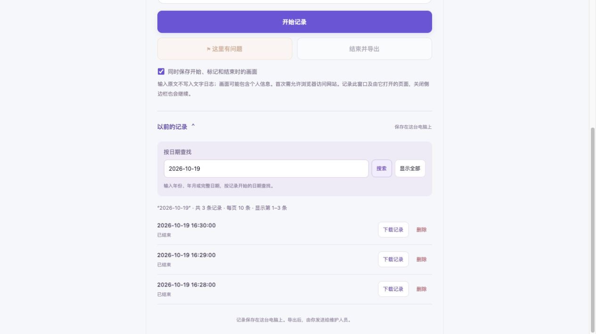

# BugSnap

**Record what happened on a website, then share one file with the people who can fix it.**

BugSnap is a Chrome Manifest V3 extension for collecting user actions, visible page feedback, screenshots, and technical diagnostics. Its default interface is designed for people who do not use developer tools.

[Download the latest release](https://github.com/WinglokWong/bugsnap/releases/latest) · [Release notes](CHANGELOG.md)

> The current extension interface is in Simplified Chinese. This README provides English installation and usage instructions.

<p align="center">
  <a href="docs/history.jpg">
    
  </a>
</p>

<p align="center"><em>History search and record management, shown with synthetic example records. Click to view at full size.</em></p>

## Three steps for users

1. **Start recording** — Open the website you want to report, click the BugSnap toolbar icon, and start a recording. Allow the requested website access when Chrome asks.
2. **Mark a problem** — Browse normally. When something goes wrong, click the problem marker. An optional note can explain what you expected.
3. **Finish and export** — Download a ZIP and send it to your developer or support contact.

There is no required title, severity selection, or manually written reproduction procedure in simple mode. Nothing is automatically sent to a server or support team.

The corresponding interface labels are:

| English meaning | Current UI label |
| --- | --- |
| Start recording | 开始记录 |
| There is a problem here | 这里有问题 |
| Finish and export | 结束并导出 |
| Download again | 再次下载记录 |
| Previous recordings | 以前的记录 |
| Search by date | 按日期查找 |
| Show all records | 显示全部 |
| Delete a recording | 删除 |

## Install

Requires **Chrome 116 or newer**. The release is an unpacked extension package, not a Chrome Web Store installation.

1. Download `BugSnap-v2.1.0.zip` from [Releases](https://github.com/WinglokWong/bugsnap/releases).
2. Extract the ZIP.
3. Open `chrome://extensions` in Chrome and enable **Developer mode**.
4. Click **Load unpacked** and select the extracted `bugsnap` folder containing `manifest.json`.
5. Pin BugSnap to the toolbar, open an ordinary website, and click its toolbar icon.

An administrator or support person can handle installation once; end users can then use the three-button workflow. No `npm install`, build step, account, or backend service is required to use the extension.

### Update an existing installation

Export any recordings you want to keep before updating. Replace the extension files in the same installation folder, click **Reload** on its card in `chrome://extensions`, and reopen the side panel.

Replacing files alone does not update Chrome's loaded permissions or background worker. If the sidebar says **更新还差一步** (One more update step), click **重新加载插件** (Reload extension), then reopen BugSnap from the toolbar. Saved records are retained; an active recording may need to be resumed. Do not remove and reinstall the extension to resolve this.

If an older recording is still running, finish it before starting a new v2 recording. Older sessions retain their original diagnostic scope rather than silently enabling additional collection.

## What is recorded

| Category | Evidence collected |
| --- | --- |
| Clicks | Control label, element type, structural path, and position |
| Input | Which field was edited or cleared; raw input text is not stored in action events |
| Choices | Checkbox/radio state and dropdown option index, not the option value |
| Submission | Form submission and Enter/Escape actions |
| Navigation | Page visits, tab changes, scrolling, and supported SPA route changes |
| Page feedback | Common alerts, status messages, dialogs, toasts, validation messages, and `aria-busy` changes |
| Requests | `fetch`/XHR starts and completions, method, sanitized URL, status, and duration |
| Errors | JavaScript exceptions, unhandled Promise rejections, `console.error`, and failed resources |
| Screenshots | Optional captures at the start, at problem markers, and at the end |

For example, **click Save → HTTP 200 → page displays “Save failed”** can produce evidence for all three observations, even without a JavaScript exception. A request that never completes still leaves a request-start event.

A nearby action ID is a timing hint, not proof that an action caused a request. An HTTP success status does not establish business success.

### Recording scope and persistence

- Simple mode follows websites visited in the recording window, plus child pages opened from tracked tabs.
- Closing the side panel does not stop collection. There is no 15-minute automatic timeout.
- Records are written to local IndexedDB as events arrive.
- Background service-worker restarts do not intentionally end a recording.
- After a full browser or extension restart, existing records remain available, but the user must resume on a page. Old tab IDs are not automatically assigned to new browsing activity.
- The UI displays a bounded preview. Full exports include all events that were successfully saved.
- Storage is finite. Write failures and collection gaps are reported; unlimited retention and zero-loss collection are not guaranteed.

## What the support team receives

Extract the **entire** recording ZIP, then open `记录.html`.

```text
recording.zip
├── 记录.html          # Human-readable timeline
├── 记录.json          # Structured recording data
├── 先读我.txt         # Short opening instructions
└── screenshots/       # Images, when successfully captured
```

The timeline combines actions, page messages, problem markers, request summaries, and errors. Screenshots use relative paths, so keep the folder together when opening the HTML or sharing it.

Recording exports are separate from the extension installation ZIP. The GitHub Release contains the extension, not anyone's browsing records.

## Privacy and permissions

BugSnap has no telemetry, remote scripts, or automatic upload endpoint. Its own recording data stays on the device until a user chooses to export and share it. The website itself continues to make its normal network requests.

Raw field values are excluded from action events. Sensitive controls receive generic labels. The collector also makes a best-effort attempt to hide known input values echoed in messages, email addresses, phone numbers, and common credential patterns.

**This is not a complete anonymization guarantee.** Page text, URL paths, user notes, and screenshots can still contain personal information. Review the export before sharing it. Screenshot capture can be disabled before starting.

| Permission | Purpose |
| --- | --- |
| `activeTab` | Temporary access for toolbar-triggered capture workflows |
| `scripting` | Inject the element picker and recording collectors |
| `sidePanel` | Display the extension interface |
| `storage` | Persist recording control state and synchronize history changes |
| Optional HTTP/HTTPS host access | Continue recording on authorized websites |
| Optional `<all_urls>` host access | Requested when simple-mode screenshot capture is enabled |

Optional access is requested when a user starts recording. Stopping collection does not automatically revoke a previously granted permission; it can be revoked through Chrome's extension settings.

The extension does **not** read request bodies, response bodies, request headers, or cookies. Ordinary `console.log` and `console.warn` output is not collected. It does not request `debugger` or `webRequest` permissions.

## Find and manage previous recordings

Open **以前的记录** (Previous recordings) to browse saved recordings:

- Each page contains up to **10 records**, newest first.
- Search by the recording's start date in your browser's local time. Enter `2026`, `2026-10`, or `2026-10-19` to find a year, month, or day. Slash and Chinese date separators are also accepted.
- Use **上一页 / 下一页** (Previous / Next), or enter a page number and click **跳转** (Go).
- Click **下载记录** (Download recording) to export any saved recording.
- Click **删除** (Delete) and confirm the displayed date to remove that recording and its stored events, screenshots, and notes. Downloaded files are not affected. Finish an active recording before deleting it.
- Deleting the last record on a page automatically moves to the previous available page. Other recordings are retained.

Version 2.1 focuses entirely on recording and sharing. The former advanced element picker, manual issue form, annotation tools, and screenshot comparison interface have been removed. Updating does not erase stored recordings. Legacy manual-report storage is left untouched, but is no longer exposed in this interface.

## Known limitations

- This is an evidence timeline, **not a screen recording or a complete session-replay engine**.
- Custom components, complex Shadow DOM, cross-origin frames, canvas internals, and arbitrary visual changes may not be captured fully.
- Page collectors do not cover browser UI, internal Chrome pages, the Chrome Web Store, or Worker internals. Continuous recording targets ordinary HTTP/HTTPS pages.
- Very early events before a new document connects, or events during crashes and page teardown, may be missed.
- CSP restrictions, cached native function references, frozen APIs, or page modifications can affect coverage.
- Screenshots are compressed. A recording allows up to 12 automatic screenshot attempts. Failed captures or the limit do not discard text events or problem markers.
- Screenshots are current visible-page captures, not full-page images. Animation and navigation can change the page between observations.
- GitHub/Jira integration, team assignment, automatic submission, and AI issue analysis are not included.

Validate the extension on your actual business websites before distributing it to nontechnical users.

## Development

The repository is the extension root: it contains `manifest.json` directly.

### Requirements

- Chrome 116+ for extension testing.
- Node.js 22+ for syntax checks and Node tests.
- Python 3.10+ for the preview server, ZIP validation, and release packaging.

There are no runtime or npm dependencies to install.

```sh
git clone https://github.com/WinglokWong/bugsnap.git
cd bugsnap
npm run check
npm test
```

### Preview and browser fixtures

From the repository root:

```sh
python3 -m http.server 8765 --bind 127.0.0.1
```

| URL path | Purpose |
| --- | --- |
| `/sidepanel.html` | Interface preview with clearly labeled demo data |
| `/test-page.html` | Manual test page for the installed extension |
| `/tests/interaction-browser.html` | Action, feedback, and privacy checks |
| `/tests/session-browser.html` | Cross-origin navigation, persistence, and stop behavior |
| `/tests/history-db-browser.html` | Atomic deletion of synthetic recordings using real IndexedDB |
| `/tests/history-preview.html` | Pagination and search using synthetic UI records |

Open these under `http://127.0.0.1:8765`. The continuous-session fixture uses both `127.0.0.1` and `localhost` on port 8765 to exercise navigation between origins.

The ordinary web preview uses sample data and does not record another website. Load the extension in Chrome for real recording.

### Build a release package

```sh
npm run build
```

Outputs:

```text
dist/BugSnap-v2.1.0.zip
dist/SHA256SUMS
```

The build includes runtime modules, icons, and documentation. Development tests and local recordings are excluded. ZIP entry timestamps are fixed so identical inputs produce identical archives.

Verify the downloaded archive using `SHA256SUMS`:

```sh
# macOS
shasum -a 256 -c SHA256SUMS

# Linux
sha256sum -c SHA256SUMS
```

### Validation status

Validation for 2.1.0: 72 automated tests passed, along with six real IndexedDB deletion/rollback browser checks. A 31-record browser fixture verified page navigation, date search, and deletion fallback; a 320-pixel iframe verified the narrow sidebar layout. The installed Chrome extension was reloaded and its three existing recordings were retained.

The automated suite covers recording continuity, error and request capture, event filtering, ZIP exports, startup compatibility, history date filtering and pagination, and deletion boundaries. Browser checks use local test pages and synthetic records. The 2.0.1 installed-extension checks also exercised the permission flow and cross-origin recording with exported screenshots.

These checks do not establish compatibility with every website. Validate the extension on your intended business websites before distributing it to end users.

## Project structure

| Files | Responsibility |
| --- | --- |
| `manifest.json`, `background.js` | Extension entry points and orchestration |
| `app.js`, `easy-ui.js`, `sidepanel.html`, `styles.css` | User interface, startup checks, and recording controls |
| `history-ui.js`, `history-model.js` | Date search, pagination, downloads, and deletion |
| `interaction-recorder.js`, `diagnostics.js` | Main-world action, feedback, and diagnostic collection |
| `diagnostic-bridge.js` | Isolated-world event bridge |
| `event-schema.js` | Event allowlist and text filtering |
| `session-manager.js`, `session-model.js`, `session-db.js` | Persistent sessions and event storage |
| `recording-report.js`, `report.js` | Readable recording timeline, JSON, and ZIP utilities |
| `tests/` | Automated and browser test fixtures |
| `scripts/package.py` | Reproducible release packaging |
